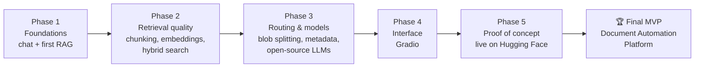

# 🧱 RAG Pipelines
### 16 notebooks from a basic chatbot to a document-routing RAG proof of concept

**The R&D behind the [AI-Powered Document Automation Platform](https://github.com/LashawnFofung/AI-Powered-Document-Automation-Platform)** (🏆 Top Performer Award, Top 10%) · Oct 2025 – Jan 2026

---

## Contents
[TL;DR](#tldr) · [The Path](#the-path) · [Benchmarks](#benchmarks-what-the-tests-showed) · [Phase 1](#phase-1--foundations) · [Phase 2](#phase-2--retrieval-quality) · [Phase 3](#phase-3--multi-document-routing--open-source-models) · [Phase 4](#phase-4--user-interface) · [Phase 5](#phase-5--proof-of-concept) · [Lessons](#what-i-learned) · [Repo Guide](#repo-guide)

---

## TL;DR

| | |
|---|---|
| **Problem** | Mortgage and HR files arrive as one scanned PDF holding many documents (pay slips, contracts, fee sheets). Basic RAG mixes them up and answers from the wrong one. |
| **What's here** | A step-by-step build: chunking and embeddings → retrieval tuning → model benchmarks → splitting and routing "blob" PDFs → a Gradio chat app |
| **Key result** | A proof of concept that splits merged PDFs, routes each question to the right document type, and cites its source — later developed into the award-winning MVP |
| **Evidence** | Timed benchmarks of 3 embedding models and 4 LLMs (see [Benchmarks](#benchmarks-what-the-tests-showed)) |
| **Stack** | LlamaIndex · Gemini · Mistral 7B · Phi-2 · TinyLlama · FAISS · BGE / MiniLM / E5 · PyMuPDF · Tesseract · OpenCV · Gradio |

---

## The Path

Every notebook opens in Google Colab from the **Open** column below.

---

## Benchmarks: What the Tests Showed

These numbers come from the saved outputs in the notebooks. They're small, single-run tests on sample documents in Google Colab, so treat them as directional, not definitive.

### LLMs answering the same RAG questions
*From [LLM Evaluation for RAG](src/Task_LLM_Evaluation_for_RAG.ipynb) — 3 questions per model, same retriever (BGE-small embeddings)*

| Model | Where it runs | Avg. time per answer | Takeaway |
|---|---|---|---|
| **Gemini** | API | **~2.2 s** | Fastest strong model; the default for reasoning |
| **TinyLlama 1.1B** | Local | ~3.6 s | Fast, but too small for reliable answers |
| **Phi-2** | Local | ~12.1 s | Good middle ground for private, local use |
| **Mistral 7B (GGUF)** | Local GPU | ~103 s | Most capable local model, but far too slow on Colab hardware |

**Product decision:** use Gemini by default, and offer a local model only when data can't leave the environment. This shaped the final platform's model switcher, which also gives Phi-2 more context chunks to make up for its size.

### Embedding models on the same contract
*From [Comparing Open-Source Embedding Models](src/Task_Comparing_Open_Source_Embedding_Models_for_RAG.ipynb)*

| Model | Index build | Query |
|---|---|---|
| **MiniLM-L6-v2** | 0.48 s | 0.03 s |
| **E5-small-v2** | 0.95 s | 0.04 s |
| **BGE-small-en** | 1.32 s | 0.06 s |

All three are fast enough for interactive use, so the choice came down to retrieval quality. The full write-ups are in the platform's [Embedding Scorecard](https://github.com/LashawnFofung/AI-Powered-Document-Automation-Platform/blob/main/Technical%20Evaluation%20Reports/Embedding%20Model%20Scorecard%20Analysis.pdf) and [LLM Comparison](https://github.com/LashawnFofung/AI-Powered-Document-Automation-Platform/blob/main/Technical%20Evaluation%20Reports/Comparative%20Analysis%20of%20Large%20Language%20Models%20%20for%20Retrieval-Augmented%20Generation%20%28RAG%29.pdf) reports.

---

## Phase 1 — Foundations
*Get a model answering, then ground it in a real document.*

| Notebook | What it adds | Data | Open |
|---|---|---|---|
| [Simple Chatbot with LlamaIndex](src/Task_Build_a_Simple_Chatbot_with_LlamaIndex.ipynb) | LlamaIndex + Gemini chat loop · [🎥 Demo](https://youtu.be/FFb6gzT8rfo) | — | [Colab](https://colab.research.google.com/github/LashawnFofung/RAG-Pipelines/blob/main/src/Task_Build_a_Simple_Chatbot_with_LlamaIndex.ipynb) |
| [Build & Optimize a RAG Pipeline](src/Task_Build_and_Optimize_a_RAG_Pipeline_for_Document_Retrieval.ipynb) | First document-grounded answers, including calculations from a fee sheet | [Lender Fees Worksheet](data/LenderFeesWorksheetNew.pdf) | [Colab](https://colab.research.google.com/github/LashawnFofung/RAG-Pipelines/blob/main/src/Task_Build_and_Optimize_a_RAG_Pipeline_for_Document_Retrieval.ipynb) |

---

## Phase 2 — Retrieval Quality
*Better chunks and better search mean better answers.*

| Notebook | What it adds | Data | Open |
|---|---|---|---|
| [Chunking & Embeddings with LlamaIndex and Gemini](src/Task_Implementing_Chunking_and_Embeddings_in_LlamaIndex_and_Gemini.ipynb) | Tests how chunk size and embedding choice affect accuracy | — | [Colab](https://colab.research.google.com/github/LashawnFofung/RAG-Pipelines/blob/main/src/Task_Implementing_Chunking_and_Embeddings_in_LlamaIndex_and_Gemini.ipynb) |
| [Comparing Open-Source Embedding Models](src/Task_Comparing_Open_Source_Embedding_Models_for_RAG.ipynb) | Times and scores MiniLM, BGE, and E5, plus a reranker | [Sample Contract](data/sample_contract.pdf) | [Colab](https://colab.research.google.com/github/LashawnFofung/RAG-Pipelines/blob/main/src/Task_Comparing_Open_Source_Embedding_Models_for_RAG.ipynb) |
| [Advanced PDF Retrieval & Optimization](src/Task_Advanced_PDF_Retrieval_and_Optimization_with_LlamaIndex.ipynb) | Query expansion, hybrid search (vector + BM25), and cross-encoder reranking | [Sample Contract](data/sample_contract.pdf) | [Colab](https://colab.research.google.com/github/LashawnFofung/RAG-Pipelines/blob/main/src/Task_Advanced_PDF_Retrieval_and_Optimization_with_LlamaIndex.ipynb) |
| [Optimized RAG + Interactive Chatbot](src/Optimized_RAG_Pipeline_with_An_Interactive_RAG_Chatbot_for_Document_Retrieval.ipynb) | Multi-turn chat with memory, using PyMuPDF and Hugging Face embeddings · [🎥 Demo](https://youtu.be/e0FKElg2wrU) | [Lender Fees Worksheet](data/LenderFeesWorksheetNew.pdf) | [Colab](https://colab.research.google.com/github/LashawnFofung/RAG-Pipelines/blob/main/src/Optimized_RAG_Pipeline_with_An_Interactive_RAG_Chatbot_for_Document_Retrieval.ipynb) |

---

## Phase 3 — Multi-Document Routing & Open-Source Models
*Handle "blob" PDFs, and know when a local model is worth it.*

| Notebook | What it adds | Data | Open |
|---|---|---|---|
| [RAG with Mistral 7B](src/Task_RAG_with_Open_Source_Model_Mistral_7B.ipynb) | Runs a quantized local model (GGUF) on GPU so data stays private | [Sample Contract](data/sample_contract.pdf) | [Colab](https://colab.research.google.com/github/LashawnFofung/RAG-Pipelines/blob/main/src/Task_RAG_with_Open_Source_Model_Mistral_7B.ipynb) |
| [LLM Evaluation for RAG](src/Task_LLM_Evaluation_for_RAG.ipynb) | Times Gemini, Mistral 7B, Phi-2, and TinyLlama on the same questions | [Sample Contract](data/sample_contract.pdf) | [Colab](https://colab.research.google.com/github/LashawnFofung/RAG-Pipelines/blob/main/src/Task_LLM_Evaluation_for_RAG.ipynb) |
| [Page-Level Detection Strategy](src/Task_Designing_a_Page_Level_Detection_Strategy_Using_RAG.ipynb) | Finds where each document starts and ends inside one PDF | [Blob File Sample](data/Blob%20File%20Sample.pdf) | [Colab](https://colab.research.google.com/github/LashawnFofung/RAG-Pipelines/blob/main/src/Task_Designing_a_Page_Level_Detection_Strategy_Using_RAG.ipynb) |
| [Tagging Chunks with Metadata](src/Task_Tagging_Chunks_with_Metadata_in_LlamaIndex.ipynb) | Tags chunks with page number and document type for precise filtering | [Blob File Sample](data/Blob%20File%20Sample.pdf) | [Colab](https://colab.research.google.com/github/LashawnFofung/RAG-Pipelines/blob/main/src/Task_Tagging_Chunks_with_Metadata_in_LlamaIndex.ipynb) |
| [Routing Queries](src/Task_Route_Queries.ipynb) | A router that sends each question to the right document type | 8 sample docs ([see data](data)) | [Colab](https://colab.research.google.com/github/LashawnFofung/RAG-Pipelines/blob/main/src/Task_Route_Queries.ipynb) |
| [End-to-End RAG with Page-Level Detection](src/Task_End_to_End_RAG_Pipeline_with_Page_Level.ipynb) | Combines splitting, tagging, and routing into one back end | [Blob File Sample](data/Blob%20File%20Sample.pdf) | [Colab](https://colab.research.google.com/github/LashawnFofung/RAG-Pipelines/blob/main/src/Task_End_to_End_RAG_Pipeline_with_Page_Level.ipynb) |

---

## Phase 4 — User Interface
*Put the pipeline in front of a user.*

| Notebook | What it adds | Open |
|---|---|---|
| [Intro to Gradio](Gradio/Task_Intro_to_Gradio.ipynb) | Maps Python functions to web UI components | [Colab](https://colab.research.google.com/github/LashawnFofung/RAG-Pipelines/blob/main/Gradio/Task_Intro_to_Gradio.ipynb) |
| [Gradio Chatbot with Lite RAG](Gradio/Task_Gradio_Chatbot_with_Lite_RAG_Implementation.ipynb) | A lightweight chat app with fast indexing and keyword retrieval | [Colab](https://colab.research.google.com/github/LashawnFofung/RAG-Pipelines/blob/main/Gradio/Task_Gradio_Chatbot_with_Lite_RAG_Implementation.ipynb) |

---

## Phase 5 — Proof of Concept

### Full RAG Pipeline with Gradio Chatbot
Solves the "blob" problem: Gemini detects document boundaries, pages are embedded with BGE-small, and each question is routed with a metadata filter so answers come only from the right document.

📓 [Notebook](Gradio/Task_Full_RAG_Pipeline_with_Interactive_Gradio_Chatbot.ipynb) · [Colab](https://colab.research.google.com/github/LashawnFofung/RAG-Pipelines/blob/main/Gradio/Task_Full_RAG_Pipeline_with_Interactive_Gradio_Chatbot.ipynb) · 📄 [Demo & Reflection (PDF)](Presentation/Full%20RAG%20Pipeline%20with%20Interactive%20Gradio%20Chatbot%20-%20Demo%20and%20Reflection.pdf)

### AI-Powered Document Intelligence POC
The full proof of concept, organized in seven sections:

| Section | What it does |
|---|---|
| Environment & secrets | Loads API keys from Colab Secrets — no keys in the code |
| Parallel OCR & image cleanup | OpenCV preprocessing plus Tesseract, run in parallel threads for long scans |
| Intelligent routing | Gemini routes each question to the right document category |
| Accuracy benchmark | Scores answers against an answer key using semantic similarity |
| Semantic document splitter | Finds the "seams" in a 50-page closing pack (deed, loan application, ID) |
| Chat UI & export | Gradio chat with source badges and an export button |

📓 [Notebook](POC/Task_Enhanced_Document_Q%26A_System_with_Intelligent_RAG_Pipeline.ipynb) · [Colab](https://colab.research.google.com/github/LashawnFofung/RAG-Pipelines/blob/main/POC/Task_Enhanced_Document_Q%26A_System_with_Intelligent_RAG_Pipeline.ipynb) · 📄 [POC Presentation](Presentation/AI-Powered%20Document%20Intelligence%20Automation%20Platform%20with%20Gradio%20Chatbot%20-%20Demo%20and%20Reflection.pdf) · 🌐 [Live POC](https://huggingface.co/spaces/lfofung/AI-Powered-Document-Intelligence-Automation-Platform) · 🖼️ [Screenshots](POC/Images)

➡️ **What came next:** the POC became the [AI-Powered Document Automation Platform](https://github.com/LashawnFofung/AI-Powered-Document-Automation-Platform) MVP, which added three swappable models, a quality audit on every answer, and PDF audit export.

---

## What I Learned

- **Retrieval sets the ceiling.** If the right chunk isn't retrieved, no model can answer correctly, so chunking, hybrid search, and reranking came before model choice.
- **Mixed documents are the real problem.** The biggest risk in a merged PDF is an answer pulled from the wrong document, so splitting and routing became the core of the product.
- **Local models trade speed for privacy.** Mistral 7B was the most capable local option but took ~100 seconds per answer on Colab hardware, so it's an option, not the default.
- **Measure, then decide.** Timing every model on the same questions turned model choice from opinion into evidence.

---

## Repo Guide

| Folder | What's inside |
|---|---|
| [`src/`](src) | Phase 1–3 notebooks: retrieval, benchmarks, splitting, and routing |
| [`Gradio/`](Gradio) | Phase 4–5 notebooks with chat interfaces |
| [`POC/`](POC) | The proof-of-concept notebook and screenshots |
| [`Presentation/`](Presentation) | Demo and reflection decks (PDF) |
| [`data/`](data) | Sample documents used for testing: pay slips, contracts, a fee worksheet, and a merged "blob" PDF |

**To run a notebook:** click its Colab link, add your Gemini key under Colab **Secrets**, and run the cells in order. A GPU runtime is needed for the local-model notebooks.

---

## Related

- [AI-Powered Document Automation Platform](https://github.com/LashawnFofung/AI-Powered-Document-Automation-Platform) — the final MVP built from this work
- [Python Document Preparation & Extraction](https://github.com/LashawnFofung/Python-Document-Preparation-and-Extraction) — the data-prep groundwork
- [AI Portfolio](https://github.com/LashawnFofung/AI-Portfolio) · [MBA Portfolio](https://github.com/LashawnFofung/MBA-IT-Management-Portfolio)

**Lashawn Fofung** · Technical Product Manager · [LinkedIn](https://www.linkedin.com/in/lashawnfofung/)

